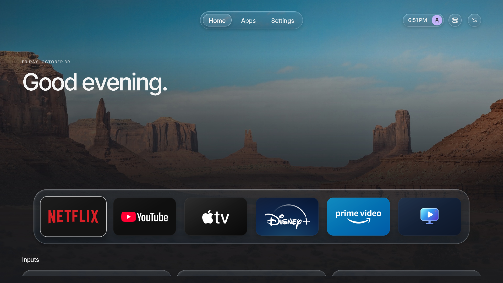
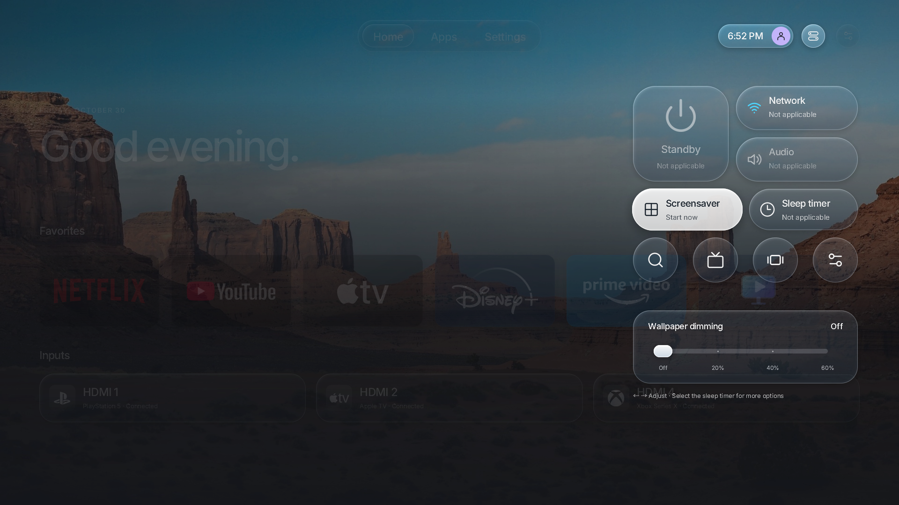
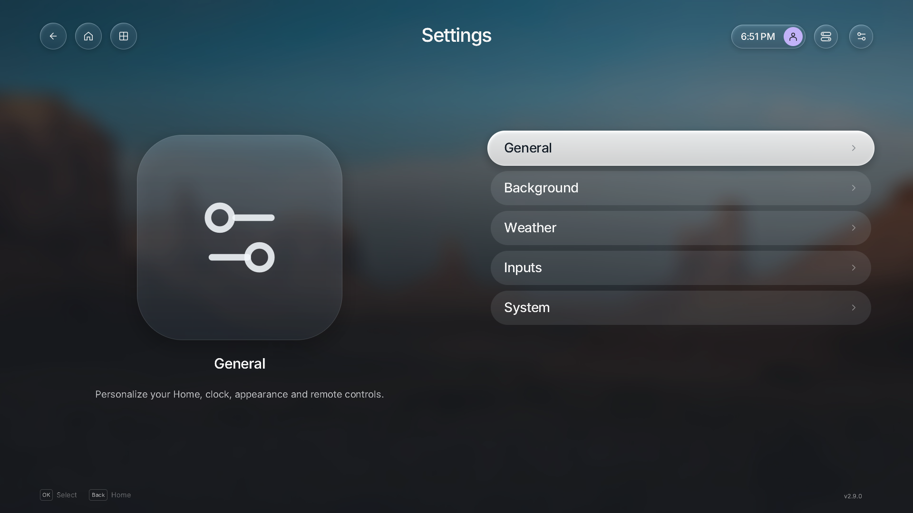

# Lumaglass

A free and open-source Home replacement and TV-management project for rooted LG webOS TVs.
Lumaglass is an independent fork of [Luma](https://github.com/ecklf/lg-luma),
with planned management features inspired by
[Glasshouse](https://github.com/rorygallagher2024/glasshouse).

The interface runs directly on the TV in Rust, SDL2 and OpenGL ES 2, with remote
and Magic Remote pointer controls. The project scope excludes a web dashboard
and an MQTT bridge.

## Feature highlights



- Personalize Home with a dock or two favorites rows, custom greetings, clock/avatar placement and input identities.
- Open quick controls from a dedicated Control Center button, browse apps with remote focus, and configure the interface through contextual settings.
- Choose Liquid Glass Off/Light/Full and import offline photos explicitly from Immich, Nextcloud/WebDAV, Drive or a computer-side Google Photos export.

| Control center                                                                        | Settings                                                         |
| ------------------------------------------------------------------------------------- | ---------------------------------------------------------------- |
|  |  |

[View all 12 screenshots and feature details](docs/media/highlights/README.md).
These are native desktop CI captures with demo data; TV verification is pending.
For the resources used by disabled features, see [runtime resources](docs/runtime-resources.md).

## Current status

The inherited native launcher includes app/input discovery, favorites, hidden
apps, recent apps, backgrounds, weather and settings. General settings now offer
optional two-row Home favorites, greeting/date personalization, section ordering
and initial focus; long Home greetings scale to fit. This fork establishes the
Lumaglass identity, modular layout, local development setup and license notices.
Settings now use a two-pane layout with contextual previews, compact lists and clear focus feedback.
Appearance settings configure card density, accent color and wallpaper dimming/blur.
Optional clear [Liquid Glass](docs/liquid-glass.md), with Off/Light/Full quality, styles the tab bar, clock/avatar,
quick controls and favorites dock. The dock is an alternative to two-row favorites.
The avatar opens a local profile with editable name and avatar style.
Opt-in [remote shortcuts](docs/remote-shortcuts.md) assign navigation actions to
the four color buttons, with desktop F1–F4 aliases and session reception indicators.
Settings → System → TV information adds read-only device information and Home
replacement observations. Preference writes run on a worker with durable atomic
replacement; the clock refreshes its timezone offset and SDK archives are SHA-256 checked.
Settings → System → Privacy reads Live Plus, limit-ad-tracking and selected
consent records. Consent records remain read-only; supported boolean setting changes
use explicit confirmation and verification. Unknown and denied values stay explicit.
**Settings → System → App management** adds an unfiltered reported app catalog,
capability details, local visibility changes, Show all and session Undo. LG Home
tile hiding remains unavailable until a firmware adapter is verified.
App options and the management catalog add a confirmed uninstall path for explicitly removable non-system
apps, with protected identities and inventory verification. Hide in Lumaglass
remains a separate local preference. TV behavior still needs hardware verification.
Confirmed Live Plus/limit-ad-tracking changes and an optional reversible LG hosts
blocker are available through System settings. [Photo services](docs/photo-services.md) add explicit Nextcloud/WebDAV and Drive imports, plus user-selected Google Photos exports. Personal local/HTTPS wallpapers,
rotation and an app-local clock/photo screensaver are configurable. An optional
[Immich album connector](docs/immich.md) imports explicitly selected albums into the
offline image cache, with credentials kept outside preferences. Render
resolution includes an experimental guarded 4K trial.
**Settings → General → System screensaver** adds compatibility inspection, a request
through LG’s idle policy, and ownership-scoped recovery. A dedicated native clock/photo
player and reversible adapter are implemented, but replacement stays disabled until an
exact firmware profile is qualified. See [system screensaver](docs/system-screensaver.md).
Consent writes and service disabling remain unavailable. Hardware verification is pending; see the [weekend checklist](docs/manual-verification.md).
See the [architecture](docs/architecture.md) for the current implementation.

The source version remains 2.9.0 until the automated Changesets version PR.
The new app ID is **`org.lumaglass.app`**, with executable **`lumaglass`**.
It installs separately from upstream Luma and does not import its preferences.
Lumaglass has not yet been verified on TV hardware. The
[compatibility reports](docs/compatibility.md) are explicitly inherited Luma results.

## Develop on macOS without global dependencies

With Xcode or Apple's Command Line Tools already selected:

```sh
sh tools/dev.sh setup
sh tools/dev.sh pnpm assets
sh tools/dev.sh pnpm dev
```

Tools and caches stay in `.build/`, `.pixi/`, `node_modules/` and `target/`.
The setup does not install Nix or Homebrew packages and does not edit shell profiles.
See [getting started](docs/getting-started.md) and [development](docs/development.md)
for the local wrapper, optional Nix environment and commands.

## Build a TV package

```sh
sh tools/dev.sh pnpm sdk
sh tools/dev.sh pnpm run package
```

The generated package is `dist/org.lumaglass.app_2.9.0_arm.ipk`, accompanied by
SHA-256 checksums and a Homebrew feed. Build and packaging do not run test suites.
The ARM target uses the webOS SDK's soft-float ABI and the pinned SDL-webOS runtime.

Read [TV installation and recovery](docs/tv-integration.md) before using Home
takeover. An existing Luma or Glasshouse Home takeover must be disabled with its
own restore command first. This fork does not remove another project's hooks.
The project is maintained at [federi95/lumaglass](https://github.com/federi95/lumaglass).
No Lumaglass release has been published yet; use a locally built package.

## Documentation

Start at the [documentation index](docs/README.md) for setup, controls, TV
integration, rendering, compatibility, releases and licensing.
The [media index](docs/media/README.md) separates current Lumaglass feature captures
from inherited Luma screenshots/video and documents their provenance.

[Control center, clock/avatar and sliders](docs/control-center.md) documents the native quick controls and header personalization.

## License and acknowledgments

Application code is MIT-licensed. The original
**Copyright (c) 2026 Luma contributors** and complete license text are preserved
in [LICENSE](LICENSE). See [NOTICE.md](NOTICE.md) for Luma and Glasshouse provenance,
and [asset provenance](docs/assets.md) for the separate artwork, font, icon and data
licenses. Original SVG/font notices remain in place. Generated derivatives retain
their applicable terms; the application license does not relicense third-party assets.

The IPK includes the original license, project notices, asset provenance,
third-party license texts and a bundle of notices from the exact locked Rust crates.
See [licensing](docs/licensing.md) for how these are maintained.
