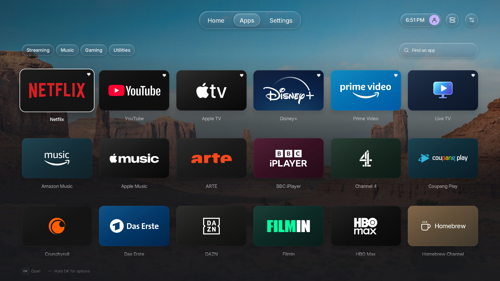
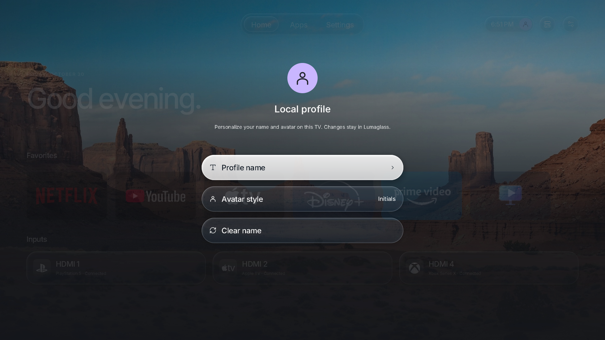
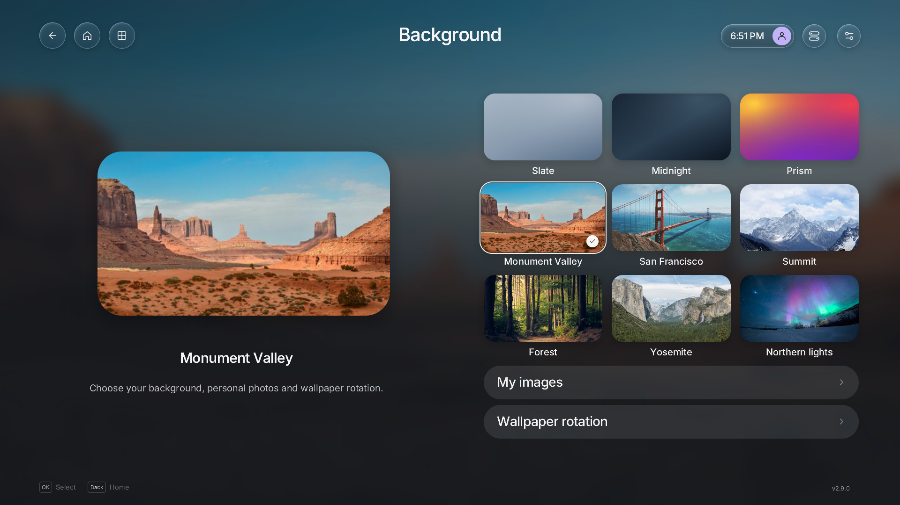
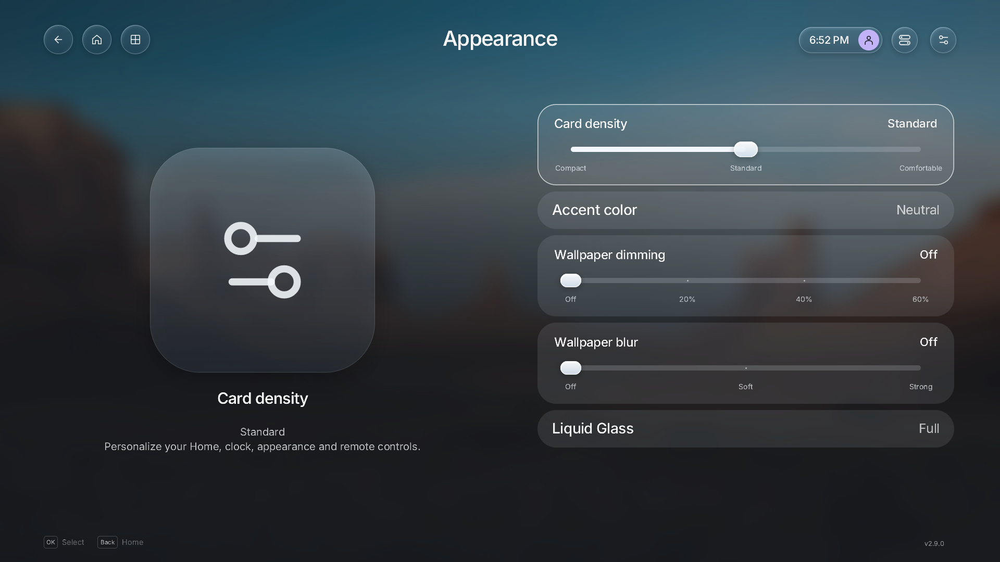
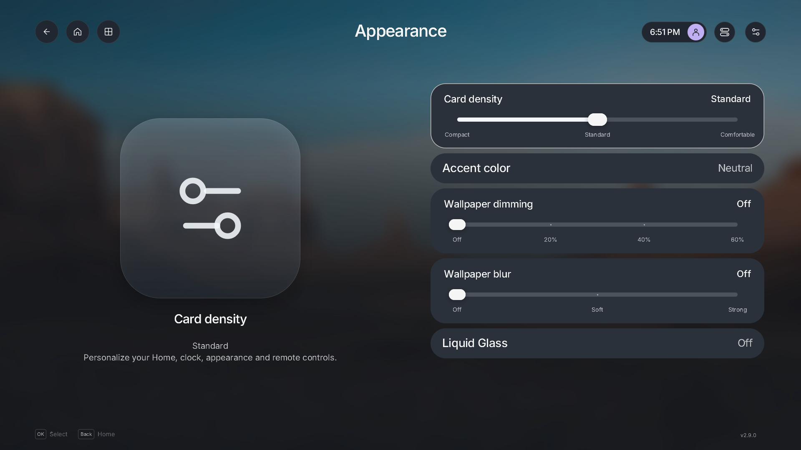
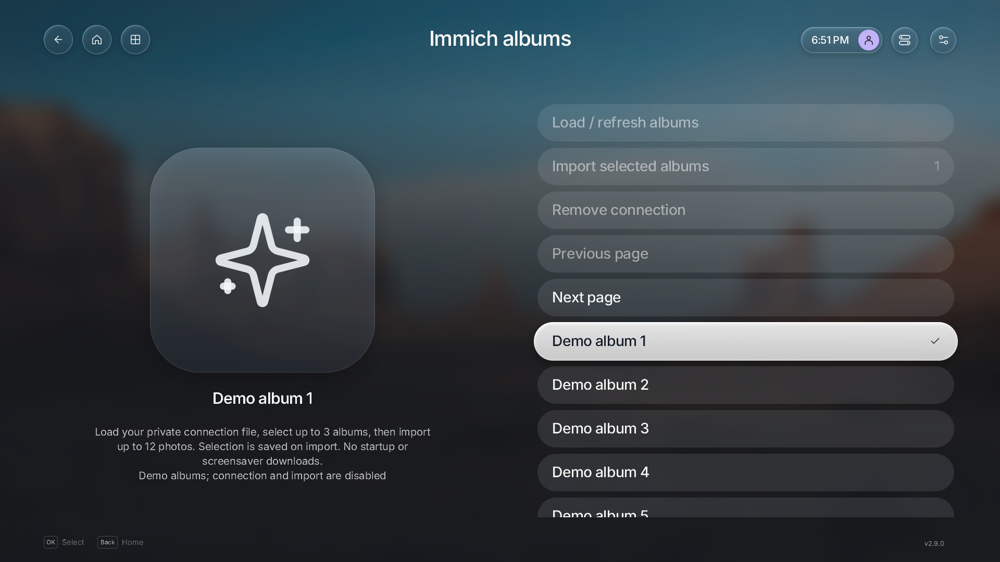
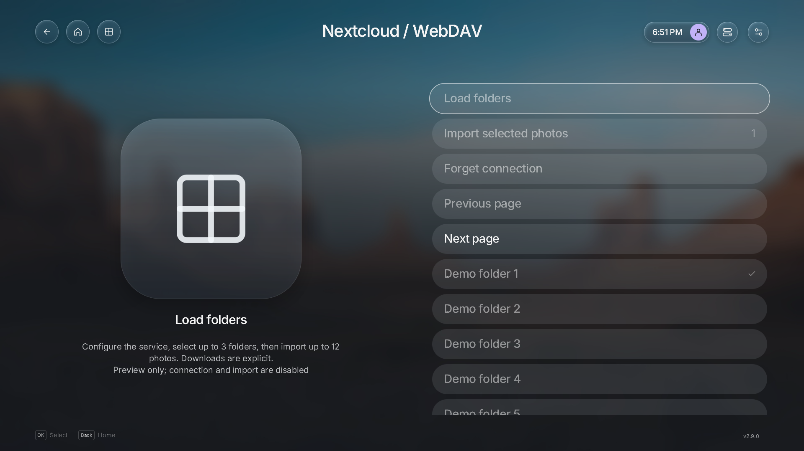
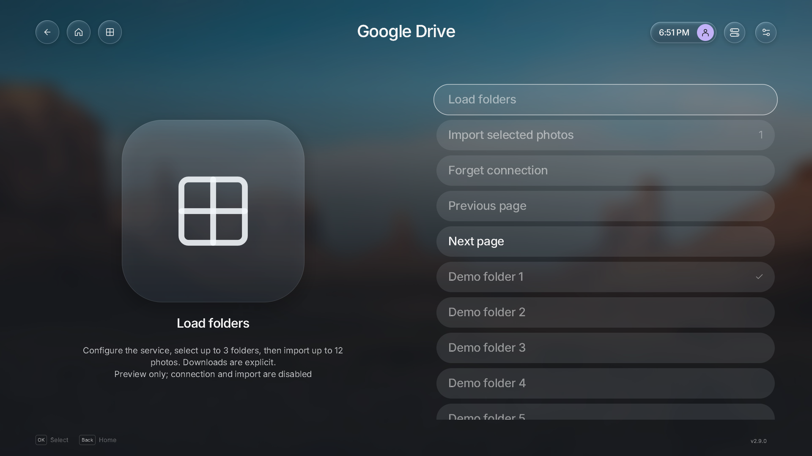
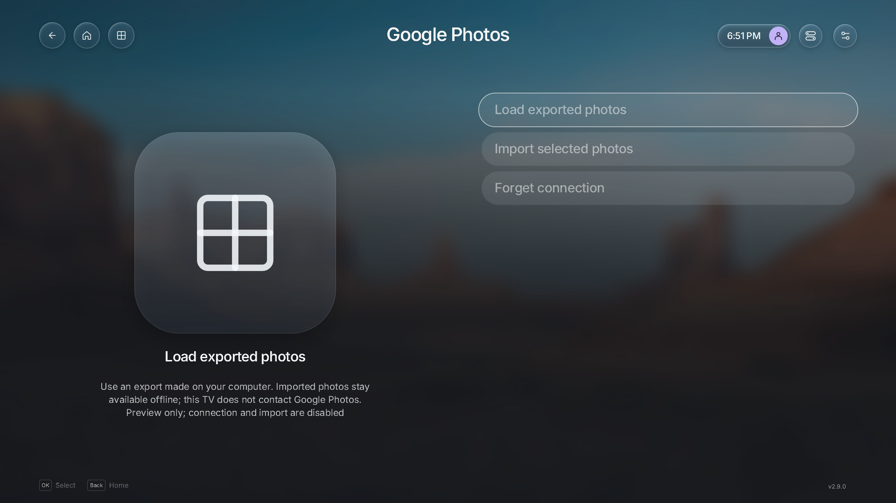

# Lumaglass feature highlights

Native screenshots of Lumaglass **2.9.0**, captured in
[CI run 41109837133](https://github.com/federi95/lumaglass/actions/runs/41109837133)
from revision [`7565a71`](https://github.com/federi95/lumaglass/commit/7565a7114cfa2db45ecdbb0bc43c6e6ea448d536).
These show the actual Rust/SDL/OpenGL interface, rendered on Ubuntu 24.04 under
Xvfb with software OpenGL. Apps, inputs and source folders/albums are demonstration
data. No personal account or TV was connected. TV firmware compatibility and
performance still require hardware verification.

## Home and apps

Choose the favorites dock or two rows of favorites. The dock hides app captions;
enabling two rows disables and locks the dock. Clock placement, greeting/date,
section order, initial focus and ordinary favorites captions are configurable.
See [Home personalization](../../home-personalization.md).

Browse apps by category, search, reorder favorites and manage visibility through
app options. Eligible user-app removal requires confirmation. Global LG visibility
adapters and system takeover remain subject to firmware qualification; this app
grid is not evidence of those operations on a TV.
See [app management](../../app-management.md).

## Quick controls and local profile

| Control center                                                                                       | Local profile                                                        |
| ---------------------------------------------------------------------------------------------------- | -------------------------------------------------------------------- |
|  |  |

A dedicated header button opens and closes the Control Center. Back or a click on
its background dismisses it. The avatar opens a separate local profile; it does
not sign into an LG or streaming account. TV-only fields correctly show **Not
applicable** in these desktop captures.
See [control center and header](../../control-center.md).

## Settings and wallpapers

| Contextual settings                                                                        | Wallpaper gallery                                                                                 |
| ------------------------------------------------------------------------------------------ | ------------------------------------------------------------------------------------------------- |
|  |  |

Settings use remote-friendly lists, contextual previews and separate focused/saved
choice indicators. Wallpaper choices include local images, explicit HTTPS imports,
offline photo imports and optional rotation.
See [appearance](../../appearance.md) and [personal wallpapers](../../wallpapers.md).

## Appearance with and without glass

| Liquid Glass Full                                                                                | Liquid Glass Off                                                                                    |
| ------------------------------------------------------------------------------------------------ | --------------------------------------------------------------------------------------------------- |
|  |  |

Off, Light and Full are user choices. Sliders support remote steps and pointer
dragging, with a visible current value and endpoints. Off removes optical sampling
and releases dedicated glass targets on the next render. The screenshots illustrate
appearance; they do not measure GPU speed or RAM on a TV.
See [Liquid Glass](../../liquid-glass.md) and [runtime resources](../../runtime-resources.md).

## Explicit photo imports

These four source screens intentionally use **demo mode**. Remote connection,
import and removal actions are disabled in the captures; folder/album selections
illustrate navigation without contacting a service. They are not captures of a
successful personal-account connection or an imported personal library.

| Immich                                                                                               | Nextcloud / WebDAV                                                                |
| ---------------------------------------------------------------------------------------------------- | --------------------------------------------------------------------------------- |
|  |  |

| Google Drive                                                                             | Google Photos local export                                                                               |
| ---------------------------------------------------------------------------------------- | -------------------------------------------------------------------------------------------------------- |
|  |  |

Immich, WebDAV and Drive use explicit, read-only source operations. Google Photos
uses a user-initiated export on a computer, followed by local import on the TV;
it does not provide automatic Google Photos library synchronization. Imported
photos can be used offline. No provider is polled at launcher startup.
See [Immich](../../immich.md) and [photo-service setup and boundaries](../../photo-services.md).

## Capture provenance and reuse

All 12 images are full-frame **1920×1080 lossless WebP** conversions of CI PNGs.
There is no resizing, compositing, retouching or replacement of UI content.
[manifest.json](manifest.json) records the source revision/run/artifact/filename,
original PNG SHA-256, published WebP SHA-256 and dimensions for each image.
Original CI artifacts have limited retention; the published files and provenance
remain in this repository.

Lumaglass UI code is MIT-licensed with upstream Luma notices preserved.
Wallpapers, fonts, icons and visible third-party marks retain their own terms;
these captures do not relicense them. See [asset provenance](../../assets.md),
[NOTICE](../../../NOTICE.md) and [licensing](../../licensing.md) when reusing images.
Streaming and console marks identify example app/input entries, without implying
affiliation or endorsement. These are Lumaglass captures, separate from the
[inherited Luma media](../README.md#upstream-luma-media).
